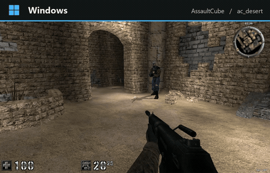
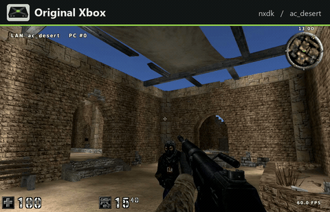

# AssaultCube on the original Xbox

**Early Xbox prototype.** Play a local deathmatch against one easy bot on `ac_desert`. First to three frags wins, with a 90-second time limit. Built with [nxdk](https://github.com/XboxDev/nxdk).

1. [Download default.xbe](https://github.com/ZacharyLeahan/assaultcube-nxdk/releases/download/xbox-prototype-2/default.xbe). The game assets are included in this one file.
2. On an original Xbox set up for homebrew, create a folder such as `F:\Games\AssaultCube\` and copy `default.xbe` into it by FTP.
3. Launch `default.xbe` from your dashboard and press **Start** to play.

Press Y before a match to choose the MTP-57 rifle, A-ARD/10 SMG, or semi-automatic TMP-M&A carbine. The guns use AssaultCube’s firing animations, recoil settings, and sounds. Shots leave sparks and bullet holes. You can hear the bot’s gunfire in stereo, jump onto barrels, and swim in the well and climb its ladder. Hold Back for the map. Press **Start** during play or **D-pad Up** from any screen for the system menu. From there you can resume, return to the dashboard, restart, or shut down the Xbox.

At 720p on an original Xbox, the first prototype missed four refreshes across a 90-second match with strafing, shooting and map use. Three shorter SMG replays reached every refresh. One test launch produced silent HDMI audio. Sound returned on relaunch.

## Private LAN crossplay

In the development build, an original Xbox and a stock Windows client can join the same PC-hosted deathmatch on `ac_desert`. Both players saw the other strafe and fire during the hardware test. [Private LAN setup](xbox/lan/README.md)

| Stock Windows client | Original Xbox |
| --- | --- |
|  |  |

[Discord MP4 (8.6 MB)](https://raw.githubusercontent.com/ZacharyLeahan/assaultcube-nxdk/master/xbox/lan/ac-desert-crossplay-discord.mp4) | [Full-resolution MP4](https://raw.githubusercontent.com/ZacharyLeahan/assaultcube-nxdk/master/xbox/lan/ac-desert-crossplay.mp4) · [Watch the original Xbox microSD recording](https://raw.githubusercontent.com/ZacharyLeahan/assaultcube-nxdk/master/xbox/lan/ac-desert-xbox-microsd.mp4) · [View the screenshot](xbox/lan/ac-desert-lan-hardware.jpg)

In one continuous 23-second take, the Xbox rounds a corner, circles the Windows player and scores the frag. Both 60 fps exports include the live Xbox FPS counter and Cam Link HDMI audio. The full-resolution version preserves both 720p views. The 50 fps GIFs show seconds 6 through 9 of the same take. The Xbox-only clip is the earlier microSD recording.

[Build instructions and controls](xbox/README.md) · [Upstream AssaultCube](https://github.com/assaultcube/AC) · [License](https://assault.cubers.net/docs/license.html)
