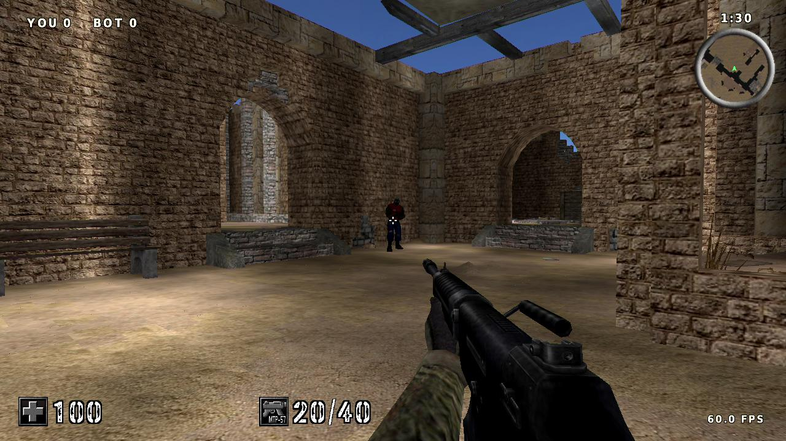

# AssaultCube on the original Xbox

Play a local deathmatch against one easy bot on `ac_desert`. First to three frags wins, with a 90-second time limit. Built with [nxdk](https://github.com/XboxDev/nxdk).

The rifle and pistol use AssaultCube’s firing animations, recoil settings, and sounds. Shots leave sparks and bullet holes. You can hear the bot’s gunfire in stereo, jump onto barrels, and swim in the well and climb its ladder. Hold Back for the map.

On an original Xbox at 720p, a 720-frame capture of the opening frag reached every refresh. Other combat captures occasionally missed a refresh.

[Build instructions and controls](xbox/README.md) · [Upstream AssaultCube](https://github.com/assaultcube/AC) · [License](https://assault.cubers.net/docs/license.html)
